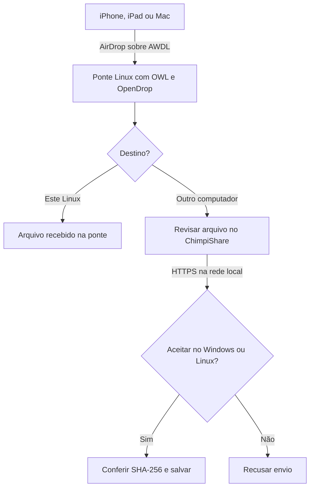

# ChimpiShare 0.1.0 — protótipo de ponte AirDrop

ChimpiShare recebe um arquivo em uma ponte compatível com AirDrop e permite
encaminhá-lo para Windows ou Linux pela rede local, depois de revisão

Os pacotes nativos e seus relatórios ficam na página de
[lançamentos do ChimpiShare](https://github.com/Chimpi-hackintosh/ChimpiShare/releases)
O código-fonte e os scripts de empacotamento estão neste repositório
Cada pacote passa por testes do transporte e abertura do aplicativo empacotado
A recepção AirDrop depende de um receptor externo compatível e ainda não foi
validada com hardware Apple neste projeto

## A arquitetura



Outra entrada suportada pelo fluxo é um **Mac que recebe pelo AirDrop nativo**
Depois de aceitar o AirDrop, o usuário seleciona o arquivo no ChimpiShare e o
encaminha ao computador de destino

A ponte termina a primeira transferência AirDrop e inicia uma segunda
transferência ChimpiShare — ela recebe uma cópia legível do arquivo
Isso não é um túnel criptografado direto entre o iPhone e o Windows

| Etapa | Implementação nesta versão | Condição |
| --- | --- | --- |
| Apple → Mac por AirDrop | Receptor nativo do macOS, externo ao app | Mac compatível e aceitação pelo usuário |
| Apple → Linux por AirDrop | Adaptador opcional que inicia `opendrop receive` | OWL configurado, `awdl0`, OpenDrop e hardware compatível |
| Linux como destino final | Arquivos permanecem na pasta da sessão OpenDrop | A recepção original ainda depende do protocolo externo |
| Ponte → Windows/Linux | Implementação própria HTTPS, revisão e confirmação | ChimpiShare nos dois computadores e conectividade IPv4 |
| Windows recebendo AWDL diretamente | Sem implementação | Exige outro trabalho de driver/protocolo |
| iPhone sem Mac ou ponte Linux | Sem implementação AirDrop direta | Não se deve anunciar o PC como receptor AirDrop nesta versão |

O arquivo original pode vir de um Mac, iPhone ou iPad
O sistema Apple não precisa instalar ChimpiShare quando envia pelo AirDrop
O envio Apple → ponte depende de a ponte realmente aparecer e completar a
recepção no AirDrop — o adaptador não garante isso

## Requisitos

- Desenvolvimento: Python 3.10 ou mais recente, Tkinter e `cryptography`
- Destino: Windows x64 ou Linux desktop — ambos podem enviar e receber pela LAN
- Ponte alternativa: macOS com AirDrop nativo, ou Linux físico com OpenDrop/OWL
- Mesma rede local acessível, ou redes com roteamento e regras que permitam a
  conexão IPv4 escolhida — acesso à internet não é necessário após instalação
- A rede não pode isolar os clientes entre si
- Em uma ponte OWL, use **Ethernet ou uma segunda placa Wi-Fi para a LAN**
  A placa usada por OWL fica dedicada ao AWDL

Não há detecção automática de compatibilidade do rádio, conta Apple, extração de
chaves do iCloud, instalação de drivers, serviço em segundo plano ou inicialização
automática

## Executar o projeto

No Windows, dentro da pasta extraída:

```powershell
py -3 -m venv .venv
.\.venv\Scripts\python.exe -m pip install -r requirements.txt
.\.venv\Scripts\python.exe run_gui.py
```

No Linux ou macOS:

```sh
python3 -m venv .venv
.venv/bin/python -m pip install -r requirements.txt
.venv/bin/python run_gui.py
```

No Linux, se Tkinter ou venv não estiverem disponíveis, instale os pacotes de
Python/Tk da sua distribuição antes — em Debian/Ubuntu normalmente são
`python3-tk` e `python3-venv`

### 1 — Computador de destino

1. Abra **Receber**, escolha a pasta e o IPv4 da interface de rede local
2. Clique **Iniciar receptor** e copie o convite completo
3. Se o Windows pedir acesso à rede, permita a conexão na sua rede privada
   A aplicação não altera o firewall automaticamente
4. Passe o convite à ponte por um canal que você controla

O convite contém um segredo de sessão e a impressão digital do certificado TLS
Ele expira quando o receptor para — não o publique em um repositório ou captura

### 2 — Receber da Apple na ponte

**Com um Mac:** aceite o AirDrop normalmente e, no ChimpiShare, abra
**Ponte AirDrop → Selecionar arquivo recebido**
O app não identifica automaticamente a origem dos arquivos de Downloads

**Com Linux:** primeiro conclua a preparação em [docs/LINUX-AWDL.md](docs/LINUX-AWDL.md)
A opção experimental só inicia OpenDrop se encontrar o comando e `awdl0`
OpenDrop aceita automaticamente os arquivos recebidos na pasta da sessão —
a confirmação do ChimpiShare se aplica à segunda transferência, não ao OpenDrop

### 3 — Encaminhar

1. Na ponte, confira que o arquivo terminou de chegar
2. Selecione o arquivo da fila ou use o seletor de arquivos
3. Na aba **Enviar**, cole o convite do destino e clique **Enviar arquivo**
4. No destino, confira o nome, tamanho e endereço da origem e aceite
5. O sucesso só aparece depois de o destino conferir e salvar o conteúdo

A fila observa uma pasta dedicada e lista arquivos sem alterações por pelo menos
3 segundos — isso é uma sugestão de estabilidade, não uma confirmação AirDrop
O encaminhamento exige seleção e comando explícito do usuário
Nada é apagado da ponte após o envio

## Comportamento do transporte

- HTTPS com TLS 1.2 ou mais recente
- Certificado novo a cada sessão, validado pela impressão digital no convite
  **antes** de enviar o token ou o conteúdo
- Token aleatório de 256 bits, válido apenas enquanto o receptor está ativo
- Confirmação manual de cada oferta e uma transferência por receptor por vez
- Limite padrão de 2 GiB por arquivo, configurável no arquivo de preferências
- SHA-256 calculado no envio e conferido novamente antes de publicar o arquivo
- Escrita temporária, publicação de diretório completo e pasta individual por
  transferência — arquivos de mesmo nome não se sobrescrevem
- Nomes incompatíveis com Windows são ajustados de maneira conservadora
- Arquivos comuns apenas — pastas e links simbólicos não são enviados
- Sem extração de arquivos compactados, abertura ou execução automática
- Até seis conexões atendidas simultaneamente e timeouts para conexões paradas

O convite identifica a sessão que você escolheu, não uma identidade Apple
Trata-se de um protótipo de transporte local, sem auditoria de segurança
Se o aplicativo ou computador for encerrado à força, uma pasta `.incoming-*`
incompleta pode permanecer — ela não será apresentada como transferência concluída

## Terminal

```sh
python -m chimpishare --version
python -m chimpishare doctor
python -m chimpishare receive --folder ./recebidos --host 192.168.1.20
python -m chimpishare send ./Arquivo.png
```

Substitua `192.168.1.20` pelo IPv4 real do computador de destino
O envio solicita o convite privadamente no terminal
Também é possível usar `--invite-file /caminho/convite-privado.txt`, preservando
o acesso privado a esse arquivo

## Idiomas e dados

A interface inclui português brasileiro e inglês
No Windows, o idioma é escolhido pela lista de idiomas de interface do sistema
Um idioma salvo no menu tem precedência e o fallback é inglês
O programa resolve recursos pela instalação, sem depender da pasta atual

Preferências ficam em:

- Windows: LocalAppData / SnoopyOS Company / ChimpiShare
- macOS: Library / Application Support / SnoopyOS Company / ChimpiShare
- Linux: XDG_CONFIG_HOME / ChimpiShare, ou ~/.config / ChimpiShare

Convites e chaves TLS não são incluídos nos padrões nem salvos nas preferências
As chaves temporárias são apagadas no fechamento normal da sessão

## Gerar executáveis

O computador de desenvolvimento precisa de Python e das ferramentas de build
O computador que instala o pacote Windows gerado não precisa de Python instalado

### Windows x64

Use Python x64 e NSIS 3 em um Windows x64, depois:

```powershell
powershell -ExecutionPolicy Bypass -File .\scripts\build_windows.ps1
```

Essa opção de execução vale só para esse processo PowerShell
O script produz primeiro `dist/ChimpiShare/ChimpiShare.exe` com runtime e
dependências, traduções separadas e verificação de ausência de fontes `.py/.pyw`
Com NSIS disponível, produz também `dist/ChimpiShare-0.1.0-Setup-x64.exe`

O instalador usa Program Files / SnoopyOS Company / ChimpiShare, cria a
desinstalação e o atalho no menu Iniciar e oferece atalho na área de trabalho
Preferências e arquivos recebidos são preservados na desinstalação
Somente o instalador exige elevação — execute o app como usuário comum

### Linux / macOS

Execute no próprio sistema de destino:

```sh
sh scripts/build_unix.sh
```

PyInstaller gera o pacote nativo em `dist` e, no macOS, também o bundle `.app`
A arquitetura acompanha o Python usado no build
No Linux, o pacote depende da compatibilidade da distribuição e da glibc —
compile numa distribuição compatível com os computadores que receberão o app

O workflow `.github/workflows/build.yml` compila Windows x64, Linux x64,
macOS Intel e macOS Apple Silicon nos sistemas correspondentes
Antes de anexar os downloads, executa o próprio binário para abrir a interface
e transferir um arquivo por HTTPS, verificando os bytes e o SHA-256
O resultado acompanha cada plataforma no arquivo `checks.json`
No Windows, verifica também instalação, atualização, desinstalação e preservação
das preferências e arquivos recebidos, usando uma pasta temporária no runner

O instalador e os executáveis não têm assinatura de uma autoridade certificadora
No macOS, o empacotador aplica assinatura ad-hoc, sem notarização Apple
O uso em uma máquina limpa e a recepção AirDrop ainda precisam de verificação
manual nos equipamentos de destino

## Verificar o código

```sh
python -m unittest discover -s tests -v
```

Os testes usam certificados efêmeros e HTTPS em `127.0.0.1`, sem acesso externo
Eles não simulam que um iPhone ou rádio AWDL tenha sido testado
Veja [TEST-REPORT.md](TEST-REPORT.md) e os relatórios dos pacotes para os resultados

### Publicação

Um push em `main` ou execução manual do workflow inicia as quatro compilações
Somente depois de todas passarem, os pacotes, fontes e somas SHA-256 são anexados
ao rascunho da versão indicada em `chimpishare/__init__.py`
A publicação do lançamento é feita após conferir os anexos
Versões já publicadas não têm seus downloads substituídos automaticamente

## Fontes técnicas

Consultadas em 29/10/2026:

- [OpenDrop — implementação, requisitos e limitações](https://github.com/seemoo-lab/opendrop/blob/master/README.md)
- [OWL — hardware, awdl0 e uso exclusivo do Wi-Fi](https://github.com/seemoo-lab/owl/blob/master/README.md)
- [OWL — repositório arquivado em 12/10/2026](https://github.com/seemoo-lab/owl)
- [PyInstaller — empacotamento nativo e opções](https://pyinstaller.org/en/stable/usage.html)
- [Cryptography — criação de certificados](https://cryptography.io/en/latest/x509/tutorial/)

OpenDrop e OWL são projetos externos GPL-3.0, não incluídos neste pacote
O ChimpiShare não é um produto da Apple nem usa uma API oficial AirDrop para Windows
